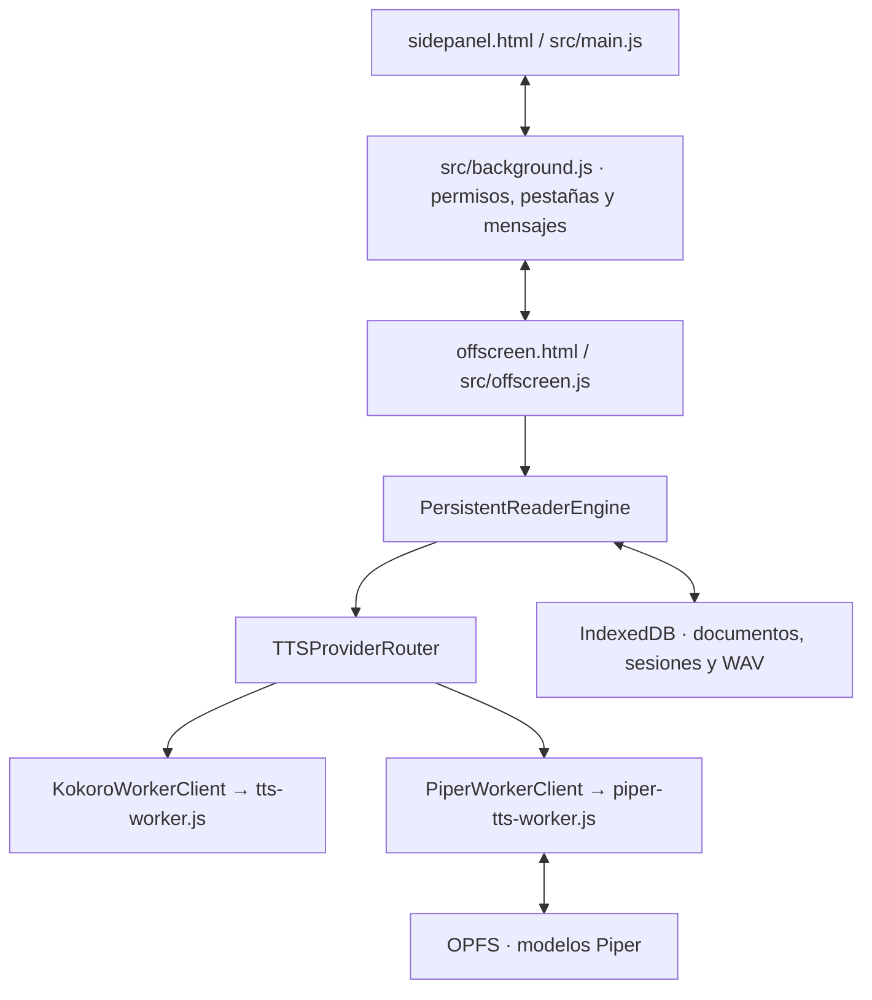

# Arquitectura de eTTS_Reader

Este documento describe los límites que tiene que respetar cualquier cambio estructural. Es una referencia conceptual; cuando haya una discrepancia, verifica la implementación actual y actualiza este documento en el mismo cambio.

## 1. Vista general

eTTS_Reader es una extensión de Edge Manifest V3. La interfaz vive en el Side Panel, mientras que la reproducción y la inferencia se mantienen en contextos separados para evitar bloquear la UI y permitir que la lectura continúe cuando el panel se oculta.

### Responsabilidades por contexto/módulo

| Componente | Responsabilidad | Límites |
|---|---|---|
| `sidepanel.html`, `src/main.js` | Editor, importación, selector de voz, controles, biblioteca y estado visual | No ejecutar inferencia pesada ni ser la única autoridad de la reproducción |
| `src/background.js` | Eventos de extensión, permisos, captura y autorización de pestañas, menú contextual, creación y mensajería hacia offscreen | No mantener vivo el worker artificialmente ni leer el contenido de una página sin acción/permisos válidos |
| `offscreen.html`, `src/offscreen.js` | Crear el repositorio, router y motor persistente dentro del contexto de audio | Una sola autoridad de sesión activa; no duplicar el reproductor en el panel |
| `src/persistent-engine.js` | Procesar comandos, organizar cola, sintetizar fragmentos, guardar progreso y preparar como máximo el siguiente fragmento | No acoplar la lógica a un proveedor concreto |
| `src/player-controller.js` | Estado de reproducción del WAV, progreso, pausa, reanudación, búsqueda y navegación entre fragmentos | Debe consumir audio generado y mantener el contrato común de los proveedores |
| `src/tts-router.js` | Enrutar por identificador y proveedor de voz | Debe fallar explícitamente ante IDs desconocidos; no asumir que todo ID es Kokoro |
| `src/tts-worker-client.js`, `src/tts-worker.js`, `src/tts.js` | Worker e inferencia de Kokoro | Mantener separados sus recursos/runtime de los de Piper |
| `src/piper-worker-client.js`, `src/piper-tts-worker.js`, `src/piper-tts.js` | Catálogo Piper, fonemización, inferencia ONNX, conversión PCM→WAV y ciclo de vida del worker | Aplicar plazos por operación en el cliente, terminar workers bloqueados e ignorar sus mensajes tardíos; permitir reconstruirlos sin borrar modelos |
| `src/piper-model-store.js` | Descargar, verificar, guardar, consultar, recuperar y eliminar modelos Piper | OPFS; revisar revisión, tamaño, SHA-256 y configuración; limpiar archivos parciales y huérfanos solo cuando un manifiesto válido permita determinar su propiedad |
| `src/persistence.js` | Documentos, sesiones y caché de WAV en IndexedDB | Las migraciones deben preservar datos no relacionados con el cambio |
| `src/confirm-action.js`, `src/library-confirmation.js`, `src/storage-safety.js` | Confirmación segura de eliminaciones, presentación y reglas de protección de almacenamiento | No reintroducir diálogos nativos en las eliminaciones ya cubiertas |

## 2. Flujo de lectura

1. El usuario introduce/importa texto y prepara explícitamente la cola con **Cargar al reproductor**; esta acción prepara la cola pero no debe iniciar audio por sí sola.
2. `ReaderClient` comunica los comandos al background, que enruta al documento offscreen.
3. `PersistentReaderEngine` mantiene sesión, fragmentos, progreso y política de caché.
4. `TTSProviderRouter` identifica el proveedor según el ID persistido y llama a Kokoro o Piper.
5. El worker del proveedor genera un `Blob` WAV. El motor valida el WAV, guarda el caché cuando procede y entrega el audio al reproductor.
6. `PlaybackController` reproduce el WAV mediante el elemento `audio` del offscreen. Esto hace que los controles de tiempo, duración, pausa, búsqueda y descarga compartan el mismo flujo para ambos proveedores.
7. Durante la reproducción de un fragmento, el motor puede precargar como máximo el siguiente. Un cambio de sesión debe impedir que resultados tardíos se guarden en la sesión equivocada.

El flujo normal de voces no debe utilizar `SpeechSynthesis`: las voces españolas son Piper y las voces inglesas existentes son Kokoro.

## 3. Proveedores de voz

### Kokoro

- IDs persistidos actuales: `af_heart` y `am_michael`.
- Runtime: `kokoro-js` más Transformers.js y la versión de ONNX Runtime que resuelve Transformers.js.
- Los recursos de runtime y los archivos de voz se copian durante el build desde `vite.config.js`.
- El modelo se prepara a petición del usuario y su worker no debe inicializarse solo por abrir el panel.

### Piper

- Catálogo en `src/voice-catalog.js`; actualmente incluye Daniela (`es_AR`, calidad alta) y DaveFX (`es_ES`, calidad media).
- `PiperWorkerClient` serializa operaciones que comparten la instancia de inferencia; `PiperTTSProvider` ejecuta fonemización e inferencia ONNX en el worker.
- `PiperModelStore` obtiene los modelos desde revisiones fijadas del repositorio de voces, valida configuración y tamaño/hash y conserva los archivos en OPFS.
- El cliente del worker aplica límites de tiempo para estado, inicialización, síntesis y descarga; la descarga e inferencia también expiran si dejan de enviar progreso. Un timeout termina el worker desde el contexto de control, conserva la última fase informada y libera la cola para un intento nuevo.
- El restablecimiento del motor no elimina pesos, documentos, sesiones ni WAV y no se permite mientras Piper esté reproduciendo. La siguiente preparación crea un worker nuevo bajo demanda.
- Durante la recuperación de OPFS se eliminan archivos `.partial`; los recursos finales sin referencia solo se eliminan si el manifiesto pudo validarse. Un manifiesto inválido protege los archivos finales existentes.
- El modelo requerido se descarga solo cuando el usuario inicia su instalación. Un modelo guardado y un modelo inicializado son estados diferentes.
- Los assets de ONNX Runtime y fonemización deben servirse desde la extensión compilada. Comprueba las rutas emitidas y el empaquetado de WASM con `vite.config.js`.

Los tamaños, revisiones, hashes, licencias y procedencia concretos son datos del catálogo y de `docs/VOICE-PROVIDERS.md` y `THIRD_PARTY_NOTICES.md`; no los dupliques en esta guía.

## 4. Sesiones, almacenamiento y claves de caché

### IndexedDB

`src/persistence.js` gestiona documentos, sesiones y WAV. Una sesión contiene, entre otros datos, la fuente de texto, los fragmentos, la voz/proveedor, velocidad, posición, estado y claves de audio asociadas.

- Las migraciones de esquema deben ser aditivas y preservar registros.
- El borrado de un documento puede desvincular sus sesiones, que deben conservar el texto/progreso/audio recuperables conforme al comportamiento actual.
- El borrado de sesión solo elimina los WAV que ninguna otra sesión utilice.
- El borrado de audios no debe eliminar documentos, sesiones ni modelos.
- El borrado de un modelo no debe borrar documentos, sesiones ni modelos de otros proveedores.
- Los modelos de Piper en OPFS y los WAV en IndexedDB son recursos diferentes.

### Caché

La identidad de un WAV debe incorporar los parámetros que cambian el audio: proveedor, voz, modelo/revisión, versión de runtime y texto. No reutilices audio entre Kokoro y Piper ni entre revisiones incompatibles.

### Migración heredada

Las sesiones que usan IDs antiguos `system:` se migran al proveedor local definido en `src/voice-catalog.js`. La migración debe conservar texto, documento, fragmento, posición y velocidad, invalidar claves de audio incompatibles y no reproducir automáticamente.

## 5. Mensajería y ciclo de vida de Edge

- El background es el punto de entrada para eventos y mensajes de la extensión.
- Antes de enviar comandos, el background espera una respuesta explícita de disponibilidad del documento offscreen. Cada operación se envía una sola vez; el sondeo de disponibilidad no repite descargas ni otras acciones con efectos.
- El documento offscreen es una instancia administrada por el navegador; puede cerrarse al quedar inactivo. No añadas bucles o temporizadores para mantenerlo vivo artificialmente.
- Los comandos deben responder mediante el canal establecido y propagar errores serializables.
- Los mensajes hacia el panel pueden no tener receptor mientras está cerrado; ese caso no debe interrumpir la reproducción.
- No ejecutes una acción de síntesis, una descarga o una importación arbitraria solo por recibir un mensaje. Valida comandos, payloads e IDs.
- La restauración de una sesión conecta la UI con el estado guardado; no debe duplicar la sesión ni iniciar autoplay.

## 6. Importación y permisos

La extracción de páginas ocurre solo tras una acción explícita del usuario. El background captura y valida la pestaña autorizada y enruta la extracción al contexto adecuado. Los permisos de hosts y `tabs` son opcionales cuando así lo define `manifest.json`; no los amplíes globalmente para simplificar una función.

PDF, DOCX, TXT y Markdown se procesan localmente según los límites definidos en README. Google Docs y páginas restringidas tienen limitaciones documentadas; no afirmes que la extracción obtiene contenido inaccesible o todo el documento si no lo verifica.

## 7. Build y recursos empaquetados

- `package.json` usa ESM y Vite; `npm run build` produce la extensión en `dist/`.
- `vite.config.js` define entradas para Side Panel, offscreen y background, y copia recursos runtime concretos para Kokoro y Piper.
- Mantén `manifest.json` y `public/manifest.json` sincronizados.
- Después del build, inspecciona los recursos necesarios en `dist/`: manifest, scripts, WASM, datos de fonemización y demás archivos requeridos.
- No cargues código ejecutable desde una URL remota; solo los modelos/recursos solicitados pueden descargarse de las fuentes definidas y deben validarse.

## 8. Interfaz y confirmaciones

- Conserva el diseño compacto de tema oscuro de eTTS y la compatibilidad con el ancho del Side Panel.
- La sección de modelo/almacenamiento refleja el estado de instalación e inicialización del proveedor seleccionado.
- Usa el modal interno existente para eliminaciones de documentos/sesiones, WAV y modelos. Respeta la lógica de `storage-safety.js`; las acciones destructivas deben ser explícitas y no pueden confirmar a través de un clic en el overlay.
- Los cambios exclusivamente visuales no deben alterar la semántica o el ciclo de vida del reproductor.

## 9. Documentos de referencia

- Desarrollo y validación: [TESTING.md](TESTING.md)
- Modelos, versiones, voces y licencias: [VOICE-PROVIDERS.md](VOICE-PROVIDERS.md)
- Avisos de terceros y cuestiones de distribución: [../THIRD_PARTY_NOTICES.md](../THIRD_PARTY_NOTICES.md)
- Instrucciones de agentes: [../AGENTS.md](../AGENTS.md)

Actualiza este documento cuando cambie una frontera arquitectónica, un contrato de proveedor, el formato de sesión o el ciclo de vida del almacenamiento; no para cualquier cambio cosmético.
